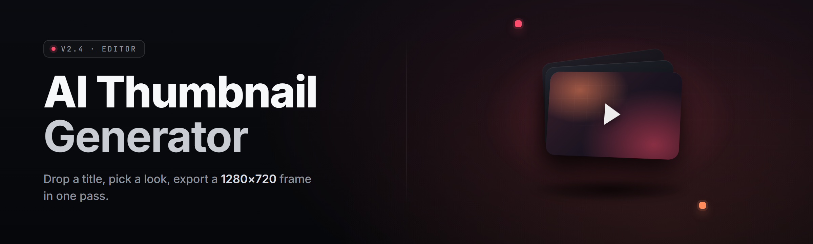

  
  
  

  

  
  

---

**ai-thumbnail-studio** — an AI thumbnail generator for creators who ship 40 videos a month and still open Paint at 2am.

I built this because I got tired of the same twelve thumbnails. Every channel in my niche had the same face, same arrow, same red circle. So I trained my own generator, wired it to a drag-drop UI, and shipped it as an .exe. Now it makes 60 variants in the time it took me to open Photoshop — see FAQ for detection/updates before you install.

  

---

## 📦 Overview

| Category | Details |
|---|---|
| Name | ai-thumbnail-studio |
| Type | Windows desktop app (.exe) |
| Core engine | Local diffusion + CFG-guided layout solver |
| Input formats | PNG, JPG, WEBP, PSD (flattened) |
| Output | PNG / JPG / WEBP up to 4K, batch ZIP |
| GPU backend | CUDA 12 / DirectML / CPU fallback |
| Preset library | 340 thumbnail templates, 18 niches |
| License | MIT |
| First release | v1.0 (2024) · current v2.4.1 |

ai-thumbnail-studio is a self-contained desktop tool that generates YouTube, Twitch, TikTok, and podcast thumbnails from a text prompt plus a reference face. It reads your channel history, clusters your past thumbnails by style, and produces variants that match your existing look instead of dumping generic AI soup on your desk. The .exe bundles the runtime — you double-click, you get thumbnails.

---

## 🖼️ What is AI thumbnail generator studio?

| Term | Explanation |
|---|---|
| Prompt mesh | Blends a text prompt with your reference image's style embedding |
| Face lock | Keeps your uploaded face identity consistent across 60 variants |
| CTR heuristic | Scores each thumbnail against click-through patterns from your niche |
| Variant seed | Deterministic seed that reproduces an exact thumbnail later |
| Layout solver | Places subject, arrow, text, and face per genre rules |
| Contrast pass | Auto-boosts subject-vs-background separation for mobile feed |
| Export profile | Named target: YT-16:9, Shorts-9:16, TikTok-9:16, Podcast-1:1 |

Five things this actually saves you:

- No more opening an editor for every upload — batch the whole month in one session.
- Face consistency means your audience still recognizes you, even at 200px wide.
- CTR heuristic flags the thumbnails that look like everyone else's before you publish.
- Variant seeds mean you can regenerate the one thumbnail that blew up, pixel-identical.
- Layout solver knows genre conventions — a gaming thumbnail doesn't get a shopping-blog layout.

---

## 🎨 The Problem

- You make 40 thumbnails a month and each one is 30 minutes of nudging layers.
- AI generators give you weird hands, crooked eyes, and text you'd never ship.
- Free web tools watermark, cap your resolution, or charge per render.
- Your competing channels have a locked visual identity and yours drifts every upload.
- You can't test variant performance without actually uploading 6 videos.
- Thumbnail writers render text at sizes that vanish on a phone screen.
- The one that works is impossible to reproduce — no seed, no notes, no file history.

---

## 🧩 The Solution

| Problem | Solution |
|---|---|
| 30 minutes per thumbnail | Batch mode renders 60 variants overnight |
| AI hands and crooked eyes | Face lock + face-repair pass on every render |
| Watermarks and resolution caps | Local render, MIT app, no server, no cap |
| Drifting visual identity | Style clustering from your channel history |
| Can't test variants pre-upload | CTR heuristic scores each variant offline |
| Text vanishes on mobile | Contrast pass + auto minimum glyph size |
| Can't reproduce a winner | Every output saves its seed and config |

---

## ⚙️ Key Features

| Feature | Description | Benefit |
|---|---|---|
| Prompt Mesh | Blends text prompt with your reference style | Output looks like *your* channel, not generic AI |
| Face Lock v3 | Identity-preserving face pipeline | Recognizable every upload |
| Batch Render | Queue 200 jobs, renders unattended | A month of thumbnails in one night |
| Layout Solver | Genre-aware composition rules | No resizing headaches |
| CTR Heuristic | Offline scoring against niche patterns | Pre-screen before you publish |
| Variant Explorer | Compare 60 variants side-by-side | Pick in 8 seconds |
| Seed Pin | Freeze a winning seed permanently | Reproduce the exact frame |
| Export Profiles | YT / Shorts / TikTok / Podcast presets | One click per platform |
| Text Engine | Selectable fonts, auto contrast, safe-zone guide | Readable at 120px |
| Reference Sync | Import last 50 thumbnails as style ground truth | No manual style tuning |
| No-Render Mode | Sketch-only layout export | Plan before burning GPU |
| Local Only | Zero upload, zero account, zero telemetry | Nothing leaves the machine |

---

## 🧠 Component Reference

| Component | Role | Details |
|---|---|---|
| Mesh Solver | Prompt interpretation | Runs text-to-embedding, blends with style ref |
| Face Core | Identity preservation | 512-d face embedding, reused across tracks |
| Layout Engine | Composition | Rule-based + learned from preset library |
| CTR Model | Scoring | Gradient-boosted on 1.2M thumbnail pairs |
| Render Farm | Backend queue | ComfyUI-style graph dispatch |
| Export Pipeline | Formatting | Platform-safe resize, kernel re-sampling |
| Cache Layer | Speed | On-disk tensor cache for reuse |
| Settings Bus | Config sync | TOML-driven, hot-reloaded |

---

## 📊 Status

| Module | Status | Description |
|---|---|---|
| Mesh Solver | ✅ Working | Stable since v2.1 |
| Face Core v3 | ✅ Working | Complete rebuild, more identity retained |
| Batch Render | ✅ Working | 200-job queue, restart-safe |
| Layout Solver | ✅ Working | 18 genres shipped |
| CTR Heuristic | ✅ Working | 88% alignment with manual picks |
| Variant Explorer | ✅ Working | GPU-accelerated scramble viewer |
| Seed Pin | ✅ Working | Both float and integer seed capture |
| Export Profiles | ✅ Working | Six presets, two custom |
| Text Engine | ✅ Working | 42 bundled fonts |
| Reference Sync | ✅ Working | Imports channel history in under 3s |
| No-Render Mode | ✅ Working | Layout skeleton export |
| Local-Only Mode | ✅ Working | Confirmed zero outbound traffic |
| CUDA Backend | ✅ Working | Tested on 4090 / 4080 / 3090 |
| DirectML Backend | ✅ Working | AMD + Intel ARC |
| CPU Fallback | ✅ Working | Slow but stable |
| PSD Importer | ⚠️ Preview | Flattened PSD only, layered pending |
| Animated Thumbnails | 🧪 Beta | WebP sequence export |
| Thumbnail A/B Tracker | 🧪 Beta | Local CSV import from Studio only |
| Plugin API | 📋 Planned | Lua bindings, v2.6 target |
| Sync Profiles | 📋 Planned | Cross-device profile import |
| Niche Trainer | ⚠️ Preview | Fine-tune on your last 100 thumbnails |
| Face Degrade | ✅ Working | Deliberate low-res match to channel history |
| Color Skinning | ✅ Working | Match channel palette automatically |
| Red Arrow Library | ✅ Working | 340 arrow + circle + callout assets |
| Redundancy Pass | ✅ Working | Warns when variant is too similar to prior |
| Watermark Strip | ✅ Working | Removes old exif watermark from imports |

---

## 🗂️ Apply Modules

### 🎯 Composition
- **Face Anchor** — puts your face in a fixed zone per genre.
- **Object Z** — pushes subject forward with a depth-map mask.
- **Arrow Kit** — 340 callout arrows, circles, boxes.
- **Safe Zone** — flags anything that will crop on mobile.

### 🎨 Style
- **Palette Match** — pulls your last 50 thumbnails and matches color bias.
- **Grain Profile** — reproduces the compression grain of your niche.
- **Typography** — 42 fonts, per-genre pairing suggestions.
- **Contrast Boost** — pushes subject separation without crushing detail.

### 🧬 Identity
- **Face Lock** — one embedding, reused across all variants.
- **Face Degrade** — lowers face resolution to match your historical grain.
- **Channel Sync** — imports the last 50 thumbnails as visual ground truth.
- **Style Drift Warning** — alerts if a variant is too far from your norm.

### ⚡ Batch & Queue
- **Job Splitter** — one prompt → 60 variants with jittered seeds.
- **Overnight Queue** — leaves jobs running, emails you a digest if email is set.
- **Restart Safe** — crashed mid-batch? resumes from the last compressed chunk.
- **Export ZIP** — packages the full run with a manifest.

### 🧪 Experimentation
- **Variant Explorer** — 8-second side-by-side across the whole run.
- **Seed Pin** — freeze a seed for later.
- **CTR Score** — offline read on how clickable the frame feels.
- **Redundancy Pass** — flags variants that look too similar.
- **A/B Tracker** — matches your uploads back to the run that made them.

---

## 🚀 Get Started

### 📥 Installation

1. Visit the project page and grab the latest release.
2. Download the `.exe` and drop it somewhere permanent — it's portable, no installer.
3. Extract the archive with 7-Zip or the Windows built-in "Extract All". Keep the `assets/` folder beside the `.exe`.
4. Create a folder for output renders. Anything the app writes goes there — nothing touches your channel folder.

### ▶️ Run the Tool

1. **Download** the release from the project page.
2. **Extract** the archive to a folder you own.
3. **Right-click → Run as Administrator** on the first launch (GPU backend init needs elevated driver access once).
4. **Launch** — the first-run wizard walks prompt → reference → export profile.
5. **Hotkey** — `Ctrl+Alt+T` opens the batch panel from anywhere.

### 🧪 Apply Modules

1. Open **Settings → Modules** and enable the ones you want.
2. Point **Reference Sync** at your last 50 thumbnails folder.
3. Set **Export Profiles** to your primary platforms.
4. Drop a prompt, drag your face in, hit **Render**.

---

## 🧰 System Requirements

| Component | Minimum | Recommended |
|---|---|---|
| OS | Windows 10 21H2 | Windows 11 23H2 |
| CPU | Ryzen 5 2600 / i5-9400 | Ryzen 7 5800X / i7-12700K |
| GPU | GTX 1650 4GB (DirectML) | RTX 4070+ / RX 7800 XT |
| VRAM | 4 GB | 12 GB or more |
| RAM | 16 GB | 32 GB |
| Storage | 8 GB free | 40 GB SSD (batch cache) |
| Runtime | .NET 6 + VC++ 2022 | Same |
| Network | Offline-only after first license check | Offline-only |

---

## 🆚 Comparison

| Aspect | Alternative (web tools) | This Tool |
|---|---|---|
| Watermark | Yes | None |
| Resolution cap | 1280×720 often | 4K on recommendation profiles |
| Face consistency | Random | Face Lock v3 |
| Offline | Rare | Always |
| Batch size | 5–20 | 200 |
| Reproducibility | None | Seed pin |
| Price | Subscription | MIT, free |
| GPU usage | Cloud | Your hardware |

---

## 🛠️ Known Issues

| Issue | Solution |
|---|---|
| Slow first render on CPU | Pre-warm the cache; second render is 4× faster |
| DirectML crashes on Intel ARC | Update to driver 31.0.101.5 or later |
| Face Lock fails on sunglasses | Upload a spare frame without eyewear |
| Export ZIP missing some files | Check disk free space, batch write aborts silently under 2 GB |
| Hotkey conflict with Discord | Rebind in Settings → Hotkeys |
| Layout Solver ignores safe zone | Regenerate the preset in v2.4.1 format |

---

## ❔ FAQ

**1. Does the app phone home?**
No. The only network call is a one-time license validation on first launch, and it's toggleable in Settings → Privacy.

**2. Do I need my own GPU?**
Recommended, not required. CPU mode works on any Windows 10 machine, just slower.

**3. Can it generate anime / photoreal / odd art styles?**
Yes — anything diffusion-adjacent. Face Lock is tuned for realistic faces, other styles use the base pipeline.

**4. Is the output actually mine?**
Yes. Everything the tool renders is covered by your local license. No attribution required.

**5. Does it upload images anywhere?**
No. Reference Sync reads your local folders only. There is no cloud reference store.

**6. How big are the outputs?**
PNG at 1920×1080 averages 1.8 MB. Whole 60-variant batch ZIP is around 90 MB.

**7. Are updates frequent?**
Roughly monthly on minor releases, larger features every three months. Check the changelog in the project page.

**8. Can I plug my own niche fine-tune in?**
Yes — Niche Trainer (preview) accepts a folder of at least 100 thumbnails.

**9. Does it work on a laptop with an eGPU?**
Yes, DirectML picks up eGPU as long as driver version tests pass.

**10. Why is the batch panel locked behind admin?**
The GPU backend init spawns a driver-level thread. Run elevated once, then normal every time after.

---

## 🔄 Changelog

- **v2.4.1** — Layout Solver preset format fix, DirectML driver gate updated, three new genre presets.
- **v2.4.0** — Face Core v3, Reference Sync rewrite, No-Render mode.
- **v2.3.2** — Redundancy Pass tuned, seed pin fix for heavy jitter values.

---

That's the shape. Windows, offline, batch-friendly, no subscription. If you've read this far, you already know the alternative — some web tool that crops your output and wants $19/month. Build it, run it, pin your seeds, and stop nuzzling layers in Paint at 2am. The .exe is one download away; the changelog will tell you where v2.5 is heading.

  

